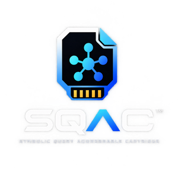

# SQAC replaces agent-facing `.md` files



**Give your LLM a memory it can carry in a file.** SQAC (Symbolic Query Addressable Cartridge) turns facts, skills, session context, agent personas, and secrets into portable `.sqac` cartridges that any LLM can query at runtime — no retraining, no vector database, no GPU required.

[](https://pypi.org/project/sqac/)
[](https://pypi.org/project/sqac/)
[](https://github.com/sensesVoid/sqac/actions/workflows/ci.yml)
[](LICENSE)

Your agent already reads `AGENTS.md`, `CLAUDE.md`, skill files, and handoff notes on every session — the same files, rewritten by hand, re-read in full, and never queried. SQAC swaps them for structured memory your model can *search* instead of *reread*.

```text
Ask your LLM: "Who owns the payments service?"

Without SQAC:  "The Federal Reserve Bank of New York maintains the
                payment system."        (confidently wrong — hallucination)
With SQAC:     "Team Atlas maintains the payments service."  (correct, from your data)
```

That gap is the entire product: a frozen, never-trained model answered private questions correctly because we handed it a 2.5 KB memory file. Also, unlike your model's training data, you can actually update it.

## Install

```bash
pip install sqac                  # core
pip install "sqac[mcp]"           # MCP server for agent clients
pip install "sqac[server]"        # HTTP API server
pip install "sqac[cloud]"         # cloud sync (R2/S3/Supabase/MinIO/B2/Spaces)
pip install "sqac[vault]"         # OS keychain for vault secrets
pip install "sqac[all]"           # everything
```

Python 3.10–3.13. Windows, Linux, macOS (x86_64 prebuilt wheels; aarch64/macOS wheels coming post-1.0).

## Quick start (60 seconds)

```bash
# Teach it a fact
sqac teach "We deploy to ARM64 only" --key deploy-target

# Ask it back — try paraphrasing; fuzzy + semantic tiers handle it
sqac search "can we ship x86 images?"
# → "We deploy to ARM64 only"  (confidence 0.72)

# Build memory from a whole project
sqac init .
sqac search "how does authentication work?"
```

If it doesn't know, it says so. SQAC would rather tell you "I don't have that in memory" than invent an answer — a level of humility your model could learn from.

## Pick your path

### I use coding agents (opencode, Claude Code, Codex, Cursor, Zed)

One memory dir, every CLI, every session. The memory follows you when you switch tools:

```bash
sqac mcp setup --host all          # prints wiring snippets for every supported CLI
sqac-mcp                           # runs the MCP server (add [mcp] extra first)
```

Then in any agent session: `mem_bootstrap` loads your working context (project, goal, last handoff), `mem_checkpoint` saves it at task boundaries. Agent personas and working state live in agent cartridges:

```bash
sqac agent init atlas --role "coding assistant"
sqac agent set identity "I am Atlas. I prefer tests before implementation."
sqac agent bootstrap               # the 4 KB "get to work" packet for a fresh session
```

→ Full details: [docs/AGENT.md](docs/AGENT.md), [docs/MCP.md](docs/MCP.md)

### I need to keep secrets out of my prompts

Regular cartridges are plaintext. Secrets and PII belong in the encrypted vault:

```bash
sqac vault init                    # AES-256-GCM, OS keychain or passphrase
sqac vault put openai --type secret
sqac vault exec --env OPENAI_API_KEY=vault:openai -- python script.py
```

MCP vault tools are reference-only: no tool ever returns a plaintext secret. Your model can *use* your API key without ever *seeing* it — like a valet with your car, minus the tipping.

→ Full details: [docs/VAULT.md](docs/VAULT.md)

### I want memory to survive a laptop-bucket-and-coffee incident

Sync cartridges to any S3-compatible store (Cloudflare R2 by default):

```bash
sqac cloud init --provider r2 --bucket my-memory
sqac cloud sync
```

Conflict-aware, explicit allowlist, never silently overwrites. → [docs/CLOUD.md](docs/CLOUD.md)

### I just want the file format

`.sqac` is a self-contained binary format: header + vocab + entries, versioned and forward-compatible. → [docs/FORMAT.md](docs/FORMAT.md)

## What lives where

| Cartridge | Holds | encrypted |
|---|---|---|
| `memory` (default) | facts, skills, docs, session turns | no (plaintext by design) |
| `agent` | persona + working state (identity, goals, decisions) | opt-in (SQAE) |
| `vault` | secrets, PII | yes (AES-256-GCM) |
| `secret` | secret *references* + metadata (never values) | yes (SQSE) |

Every entry is retrievable three ways: **exact** key lookup (O(1)), **lexical/fuzzy** matching (SIMD-accelerated), and optional **semantic** matching for paraphrases. No hit → no answer, never a confident guess.

## Features

### Memory core
- **Portable `.sqac` cartridges** — one self-contained binary file per memory (magic header + vocab + entries), versioned and forward-compatible. `pip install sqac`, no database.
- **Three-tier retrieval** — exact key lookup (O(1)); lexical/fuzzy recall over 1024-bit keys (Rust SIMD popcount, numpy fallback); optional static-embedding semantic tier (numpy — no torch required)
- **Fail-safe confidence gate** — below threshold, SQAC says "not in memory" instead of guessing
- **Flat-cost stats at scale** — incremental per-kind counters keep `sqac stats` O(1) regardless of cartridge size; `nlargest` selection instead of full sorts
- **Atomic, crash-safe saves** — single joined-buffer writer; cartridges only rewrite on explicit saves (or the debounced session flush)
- **PII & credential guard** — regex + Luhn PII detection and credential-pattern rejection run at write time; every entry carries an injection-risk `trust` score
- **Kind taxonomy** — `generic | fact | skill | doc | turn`, with auto-routing into typed cartridges

### CartridgeRack — many cartridges, one hot-swappable set
- Named cartridges with **auto-routing by kind** (`fact`→`facts`, `skill`→`skills`, `doc`→`docs`) and **auto-create on first write**
- **Folder routing** — shard your memory under subfolders (`facts/team-a.sqac`)
- **Capacity sharding** — cartridges split automatically at 25K entries
- **Hot swap** — `mem_swap` / rack swap in-process, no restart
- `sqac compact` (tombstone GC + full rewrite), `sqac stats` per-cartridge and rack-wide

### Session memory (working memory)
- **ContextOffloader** — rolling 8-turn window; exchanges are distilled and offloaded into the `session.sqac` bucket
- **DMS (Dynamic Memory Sparsification)** — utility scoring (salience, frequency, recency); `mem_sparsify` demotes low-utility exchanges to durable tier instead of deleting them
- **Session-save debounce (v1.2.2)** — `session.sqac` rewrites at most every 10 turns / 60 s; `mem_save`, `mem_checkpoint`, `mem_graduate`, `mem_swap` always flush synchronously; tune with `SQAC_SESSION_FLUSH_TURNS`/`SECS`
- **`mem_graduate`** — promote stable session findings into durable cartridges (default `facts`)

### MCP server (`sqac-mcp`) — one memory dir shared by every CLI
36 tools across six groups (see [docs/MCP.md](docs/MCP.md)):
- **Memory** — `mem_bootstrap` (cross-CLI handoff packet), `mem_checkpoint`, `mem_observe`, `mem_search`, `mem_write`, `mem_recall`/`mem_recall_detailed`, `mem_graduate`, `mem_sparsify`, `mem_swap`, `mem_save`, `mem_stats`, `mem_cartridge_create`/`mem_cartridge_list`
- **Agent** — `agent_list`, `agent_use`, `agent_show`, `agent_bootstrap`, `agent_update`, `agent_done`, `agent_search`
- **Vault (reference-only)** — `vault_list`, `vault_meta`, `vault_http`, `vault_audit` — use secrets without ever exposing them
- **Secret Domain (reference-only)** — `secret_list`, `secret_meta` — references and metadata, never values
- **Code graph** — `ast_init`, `ast_explore`, `ast_blast`, `ast_callers`, `ast_callees`, `ast_search`, `ast_stats`
- **Cloud** — `cloud_status`, `cloud_sync`
- Plus the `memory://context` resource and **cross-CLI continuity** (`continuity.json`): project goal, last host/model, checkpoint trail — pick up mid-task in any client

### Agent cartridges
- Persona + working state in one file: identity, preferences, instructions, goals, decisions, notes
- **Agent schema v2** — model-profile binding (`model_profile_id`), `secret_ref`/`secret_refs` fail-closed allowlist, `allowed_tools`, per-cartridge `sync_policy`; schema-1 cartridges upgrade automatically on save
- `sqac agent bootstrap` — compact "get to work" packet for fresh sessions; agent memory is deliberately kept out of default `mem_search` (use `agent_search`)

### Vault — encrypted secrets
- **AES-256-GCM**; Argon2id-wrapped master key or OS keychain; portable passphrase mode for machines without a secure store
- `sqac vault exec --env KEY=vault:NAME -- <cmd>` — the secret exists only in the child process environment
- `sqac vault http` / `vault_http` MCP tool — secret-injected HTTP calls; the value never enters the model's context
- Hash-chained **audit log** (`sqac vault audit`); PII scan (`sqac vault scan`); vaults default to `sync_policy: never`
- Multi-vault registry — named vaults under one directory; per-vault default policies

### Secret Domain — secret *references*, never values
- Encrypted (SQSE) registry: `vault:NAME`, `vault:VAULT/NAME`, `secret:DOMAIN/NAME`, `provider:1password:*`, `provider:bitwarden:*`, `op://`, `bw://`
- **Fail-closed allowlist** in the trusted backend, cycle guard, hash-chained audit events without values
- Resolution lives in `SecretResolver` (backend only); MCP/CLI tools return metadata only
- `sqac secret` — init/list/put-ref/get-meta/rm/rename/list-domains

### Cloud sync (S3-compatible)
- Providers: Cloudflare R2 (default), AWS S3, Supabase Storage, MinIO, Backblaze B2, DigitalOcean Spaces
- Explicit allowlist, conflict-aware — **never silently overwrites**; `sqac cloud sync` (push/pull/both)
- Per-cartridge `sync_policy` (`write_through | never | local_only`); `agent`/`vault`/`secret` default to `never`; `secrets/` is hard-denied; encrypted cartridges are treated as `never` on pull
- `sqac cloud status --show-denied` shows which local cartridges are policy-denied

### Code-graph intelligence (tree-sitter)
- `sqac graph init` — index a codebase into `graph.sqac` (Python, TS/JS, Go, Rust, and the full tree-sitter-language-pack set)
- `sqac graph explore / blast / callers / callees / search / stats` — blast radius, who-calls-what, symbol search
- `sqac graph watch` — reindex on change; also auto-builds with `sqac init .` and keeps fresh with `sqac track .`

### Ops & observability
- `sqac dashboard` — local web dashboard (port 8420, optional API key, rack mount) and `sqac viz` — 3D hyperdimensional memory graph
- `sqac report "title" -d "..."` - file a GitHub issue with diagnostics attached
- `sqac export <cartridge> [--format md|json]` - serialize a plaintext cartridge to human-readable Markdown/JSON (encrypted vault/secret payloads refuse to export); `sqac diff <old.sqac> <new.sqac> [--format md|json]` - added/removed/updated/reclassified entries between cartridge versions
- HTTP API server (`sqac-server`, FastAPI) for self-hosting memory behind your own endpoints
- 485 tests, CI across numpy fallback + Ubuntu/Windows × Python 3.10–3.13, pip-audit-clean runtime deps, full docs set ([FORMAT](docs/FORMAT.md) · [MCP](docs/MCP.md) · [VAULT](docs/VAULT.md) · [SECRET](docs/SECRET.md) · [CLOUD](docs/CLOUD.md) · [DMS](docs/DMS.md) · [SECURITY](docs/SECURITY.md) · [THESIS](docs/THESIS.md))

## The CLI in one glance

```bash
sqac teach "..." --key k            # store one fact
sqac search "query"                 # retrieve it back
sqac init .                         # auto-build memory from a codebase
sqac track .                        # keep it in sync as the code changes
sqac agent ...                      # agent personas + working state
sqac vault ...                      # encrypted secrets/PII
sqac secret ...                     # secret refs/metadata (never values)
sqac cloud ...                      # S3-compatible sync
sqac graph ...                      # AST code-graph intelligence (init/explore/blast/...)
sqac dashboard / sqac viz           # web dashboard / 3D hyperdimensional graph
sqac compact                        # tombstone garbage collection for a cartridge
sqac stats                          # memory statistics
sqac report "bug title" -d "..."    # file a GitHub issue with diagnostics
sqac mcp setup --host <cli>         # wire memory into your agent
```

→ Full feature inventory above; MCP tool tables in [docs/MCP.md](docs/MCP.md); HTTP endpoints in [`sqac-server`](sqac/server.py) (FastAPI).

## FAQ

**Is this RAG?** Not quite. RAG retrieves passages your model quotes; SQAC retrieves *facts your model uses* and *procedures your model follows* — with exact/lexical/semantic tiers, no vector DB, and a confidence gate that fails safe. If RAG is a search engine for documents, SQAC is a memory your agent can carry in its pocket.

**Does it need a GPU or embeddings service?** No. Retrieval is XOR + popcount on 1024-bit keys; the optional semantic tier runs a small static model in numpy. Storage is one file you can email to a colleague.

**Why not just keep using `AGENTS.md`?** Markdown is great for humans and terrible for retrieval: no keys, no confidence, no dedup, and your agent rereads the whole file every session. SQAC keeps the content, adds structure, and gives your model a 4 KB bootstrap instead of a 40 KB wall of text. Keep the markdown for yourself; give the cartridge to your agent.

**Can I see what it remembers?** Yes — `sqac stats`, `sqac search`, the dashboard (`sqac dashboard`), and the 3D graph view (`sqac viz`) for people who enjoy watching their memory as a glowing particle system.

**Is my data safe?** Memory cartridges are plaintext — treat them like a text file. Secrets live in vault cartridges (AES-256-GCM, keychain or passphrase). Secret references live in the Secret Domain — never values — and secret resolution happens only in the trusted backend. Cloud sync never uploads `agent`/`vault`/`secret` cartridges by default and never silently overwrites conflicts. See [docs/SECURITY.md](docs/SECURITY.md) for the full threat model, including what it does *not* protect against.

**What's the catch?** Fuzzy search is O(n) per scan — sub-100 ms up to ~100K entries with SIMD, beyond that shard your memory (DMS eviction can help). It's memory, not a reasoning engine: it retrieves the right context, your model still has to think.

## Status

- **Version:** 1.2.2 - 485 tests passing
- **Repository:** https://github.com/sensesVoid/sqac
- **Issues:** https://github.com/sensesVoid/sqac/issues

## Contributing

PRs welcome — see [CONTRIBUTING.md](CONTRIBUTING.md). Bug reports: `sqac report "title" -d "description"` files a GitHub issue with diagnostics attached.

## License

BUSL-1.1 (free to use, modify, distribute — no competing SaaS). Converts to Apache 2.0 in 2030. See [LICENSE](LICENSE).

---

*SQAC stands on hyperdimensional computing and vector-symbolic architecture research — see `docs/THESIS.md` and `experiments/` for the full record, negative results included.*
