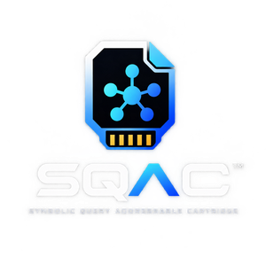

# SQAC — Symbolic Query Addressable Cartridge

**Give your LLM a memory it can carry in a file.** SQAC turns facts, skills,
session context, agent personas, and secret references into portable
`.sqac` cartridges that any LLM can query at runtime — no retraining, no
vector database, no GPU required.

## Install

```bash
pip install sqac                  # core
pip install "sqac[mcp]"           # MCP server for agent clients
pip install "sqac[server]"        # HTTP API server
pip install "sqac[cloud]"         # cloud sync (R2/S3/Supabase/MinIO/B2/Spaces)
```

## Quick start

```bash
sqac teach "We deploy to ARM64 only" --key deploy-target
sqac search "can we ship x86 images?"

sqac agent init atlas --role "coding assistant"
sqac agent bootstrap             # the 4 KB "get to work" packet

sqac vault init                  # AES-256-GCM encrypted secrets
sqac secret init                 # secret references, never values (v1.2)
sqac cloud init --provider r2 --bucket my-memory
```

## Guide

- [Repository README](https://github.com/sensesVoid/sqac) — full tour, CLI in one glance
- [AGENT.md](AGENT.md) — agent personas + working state
- [VAULT.md](VAULT.md) — encrypted vault cartridges
- [CLOUD.md](CLOUD.md) — cloud sync with per-cartridge sync policy
- [MCP.md](MCP.md) — MCP tools reference
- [FORMAT.md](FORMAT.md) — the `.sqac` binary format
- [SECURITY.md](SECURITY.md) — security model

License: BUSL-1.1 (converts to Apache 2.0 in 2030).
